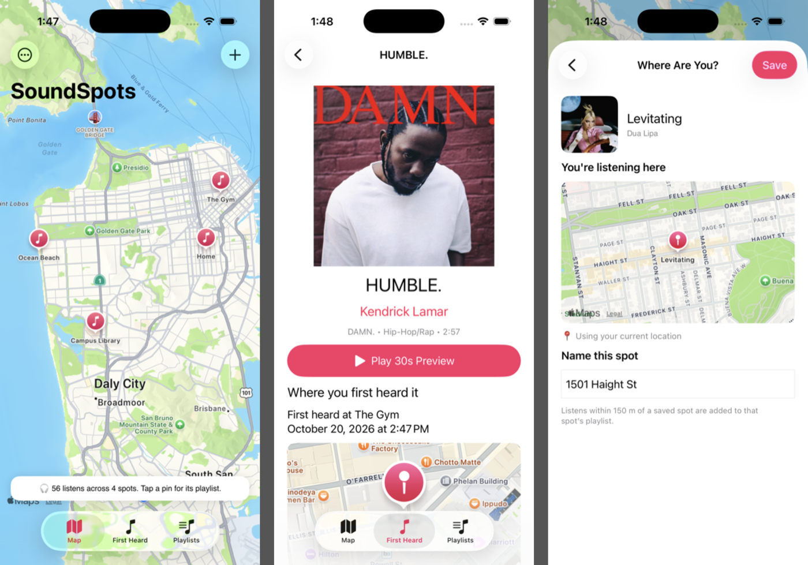

# SoundSpots 🎧📍

**Remember where you first heard your favorite songs.**
SoundSpots pins every song you log to the place you were listening, shows those places on a map, and builds a playlist for each location from the music you play there most.

Built with **Swift + UIKit + Storyboards**. No SwiftUI, no async/await.



---

## Features

| Screen | What it does |
|---|---|
| **Map** (tab 1) | Every listening spot as a pin. Tap a pin to see its top song, then tap ⓘ to open that place's playlist. The **＋** button logs a new listen. The **⋯** menu loads demo data or clears everything. |
| **Log a Listen** (modal) | Search the iTunes catalog for what you're playing. |
| **Where Are You?** (modal, step 2) | Gets your GPS location, suggests a name using reverse geocoding (e.g. "1501 Haight St"), and saves. Listens within 150 m of a saved spot join that spot's playlist. |
| **First Heard** (tab 2) | Every song you've logged, with the place and date you *first* heard it. |
| **Song Detail** | Album art, a 30-second preview, and a map of every place you've played the song. |
| **Playlists** (tab 3) | One auto-generated "Mix" per location, busiest first. Swipe to delete. |
| **Playlist** | Songs ranked by plays at that location. Sort by **Most Played / Recent / Firsts** (songs first discovered here). Swipe right to preview. |

## How to run

1. Clone this repo and open `SoundSpots.xcodeproj` in Xcode 15 or later.
2. Pick an iPhone simulator and press **Run** (⌘R).
3. On the Map tab, tap **⋯ › Load Demo Data** to fill the app with sample spots around San Francisco.

**No API key is needed.** The app uses Apple's public [iTunes Search API](https://performance-partners.apple.com/search-api).

**Simulator location tip:** the simulator has no GPS. Use **Features › Location › Custom Location…** (e.g. 37.77, -122.447). If location is unavailable, the app falls back to the map's center so logging still works.

---

## How it meets the requirements

### Swift basics
| Requirement | Where |
|---|---|
| **enum** | `PlaylistSort` (Int raw values for the segmented control, with sorting logic), `LocationSource` (associated value `.existingPlace(Place)`), `NetworkError` / `LocationError` (associated `Error` values), `SegueIdentifier` |
| **Escaping closures** | `MusicSearching.searchSongs(matching:completion:)`; `LocationService.requestCurrentLocation(completion:)` stores its closures in an array until CoreLocation answers; `ImageLoader.loadImage(from:completion:)` |
| **Protocols** (beyond table views) | `MusicSearching` (real `ITunesMusicService` and `MockMusicService` can be swapped), `ListenStoring`, `LogListenDelegate` (passes data back from the modal), `ReuseIdentifiable` (with a protocol extension), `MKAnnotation` (`PlaceAnnotation`), `CLLocationManagerDelegate`, `MKMapViewDelegate`, `UISearchBarDelegate`, `UITextFieldDelegate` |
| **class / struct** | Structs for data (`Song`, `Place`, `ListenEvent`, `ListeningHistory`, `PlaylistItem`); classes for shared services with identity (`ListenStore`, `PreviewPlayer`, `LocationService`, `PlaceAnnotation`) |
| **Optionals** | `guard let`, `if let`, `??`, `?.`, `flatMap`, `compactMap`. iTunes fields are optional and `ITunesTrack.toSong()` returns `Song?` |
| **Typecasting** | `response as? HTTPURLResponse`, `segue.destination as? …`, `navController.topViewController as? LogListenViewController`, `sender as? Song`, `annotation as? PlaceAnnotation`, `dequeueReusableCell(…) as? SongCell`, `for case let nav as UINavigationController in …`, `$0 is PlaceAnnotation` |

### UIKit
* **Main.storyboard** holds all eight scenes: a tab bar controller, 4 navigation controllers, and 7 view controllers, with Auto Layout throughout (stack views, safe areas, scroll views).
* **Components:** UILabel, UIButton, UITableView (custom prototype cells), UISearchBar, UISegmentedControl, UITextField, UIImageView, UIActivityIndicatorView, UIScrollView, UIStackView, **MKMapView**, UIMenu, swipe actions, alerts.

### API (URLSession + Codable)
`ITunesMusicService` → `https://itunes.apple.com/search?term=…&entity=song`. JSON decodes into `ITunesSearchResponse` / `ITunesTrack` (Codable), which are converted into the app's `Song` model. Artwork and preview audio come from the same API. `SampleData` provides mock data for offline demos.

### Navigation & data passing
* **Forward:** Map → Playlist (`Place`), Playlists → Playlist (`Place`), Playlist / First Heard → Song Detail (`Song`), Map → Log Listen (map center coordinate + delegate), Log Listen → Confirm (`Song` + coordinate + delegate)
* **Backward:** Confirm → Map through `LogListenDelegate`
* **Modal** presentation for the logging flow, **push** for details, **tab bar** for the 3 sections

### Persistence (UserDefaults + Codable)
`ListenStore` saves a `ListeningHistory` (`[Place]` + `[ListenEvent]`) as JSON through a generic `UserDefaults.setCodable(_:forKey:)` helper, and loads it at launch.

## Project structure
```
SoundSpots/
├── App/            AppDelegate, SceneDelegate
├── Models/         Song (+ iTunes Codable types), Place, Enums, SampleData
├── Networking/     MusicService (protocol + iTunes + mock), NetworkError, ImageLoader
├── Services/       LocationService (CoreLocation), PreviewPlayer (AVFoundation)
├── Persistence/    ListenStore, UserDefaults+Codable
├── Controllers/    7 view controllers
├── Views/          SongCell, PlaceAnnotation
└── Resources/      Main.storyboard, LaunchScreen.storyboard, Assets, Info.plist
```

## What I'd improve next
* **Automatic logging:** detect the song playing in Apple Music (MusicKit) or Spotify (Web API "currently playing") instead of searching manually.
* **Export playlists** to Apple Music or Spotify.
* **Core Data or SwiftData** instead of UserDefaults once the history gets large.
* **Map clustering** and heat maps for places with many listens.
* **Unit tests** for `ListenStore` (place grouping and playlist ranking) using the `ListenStoring` protocol and an in-memory `UserDefaults`.
